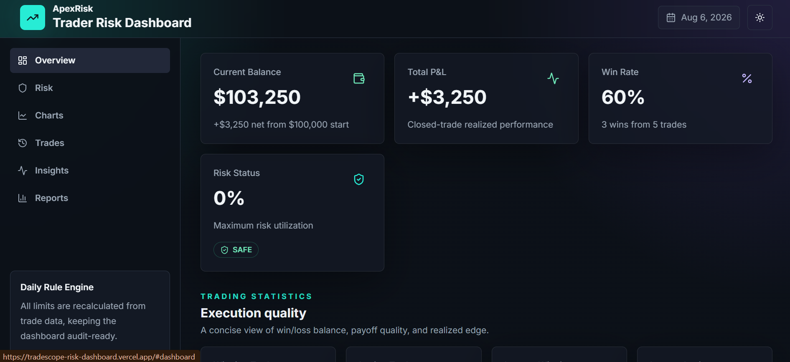
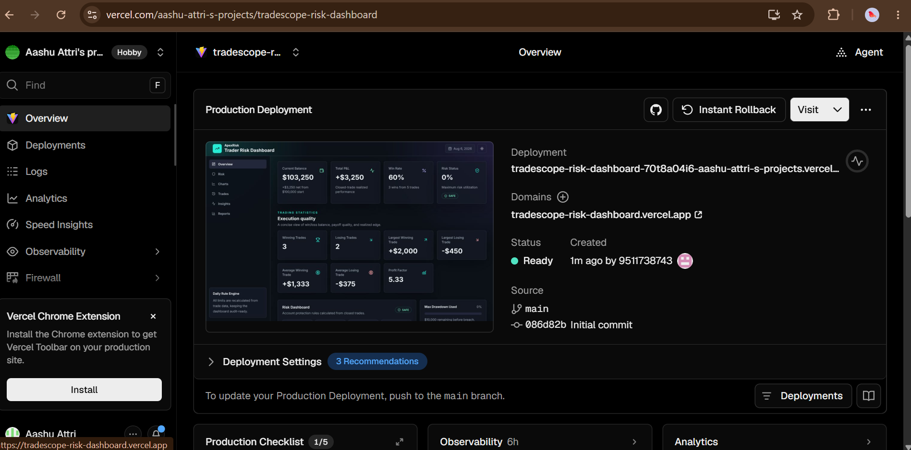

# 📊 TradeScope Risk Dashboard

> A production-ready React 19 dashboard for monitoring trader performance, account health, drawdown usage, daily loss limits, and execution statistics.


---

## 🌐 Live Demo

**Live Application:** https://tradescope-risk-dashboard.vercel.app

---

## 📂 GitHub Repository

https://github.com/akshayattri01/tradescope-risk-dashboard

---

## 📸 Screenshots

### Dashboard Overview



### Vercel Deployment



---

## ✨ Features

- Dynamic account metrics derived from local trade data
- Current balance, total P&L, win rate, profit factor, drawdown, and daily loss calculations
- Risk status engine with SAFE, APPROACHING LIMIT, and AT RISK states
- Interactive charts powered by Recharts
- Animated counters, cards, progress bars, and smooth transitions
- Responsive desktop, tablet, and mobile layouts
- Modern FinTech SaaS dark UI
- Recent trading activity and performance insights
- Accessible design with semantic HTML and ARIA support

---

## 🛠 Tech Stack

- React 19
- TypeScript
- Vite
- Tailwind CSS
- Framer Motion
- Recharts
- Zustand
- Lucide React
- shadcn/ui-inspired reusable components

---

## 🚀 Installation

Clone the repository

```bash
git clone https://github.com/akshayattri01/tradescope-risk-dashboard.git
```

Move into the project

```bash
cd tradescope-risk-dashboard
```

Install dependencies

```bash
npm install
```

Run locally

```bash
npm run dev
```

---

## 📦 Production Build

```bash
npm run build
npm run preview
```

---

## 📁 Folder Structure

```text
src/
│
├── components/
│   ├── charts/
│   ├── dashboard/
│   └── ui/
│
├── data/
├── hooks/
├── lib/
├── types/
│
├── App.tsx
└── main.tsx
```

---

## 🏗 Architecture

The application is a frontend-only dashboard built with React and TypeScript.

Trade data is stored locally and processed through reusable utility functions to calculate:

- Current Balance
- Total Profit & Loss
- Win Rate
- Drawdown
- Profit Factor
- Daily Loss
- Risk Percentage
- Risk Status

The dashboard uses memoized calculations for better performance.

---

## 📊 Risk Calculation Logic

- Current Balance = Starting Balance + Total P&L
- Total P&L = Sum of all trade profits and losses
- Win Rate = Winning Trades / Total Trades
- Profit Factor = Gross Profit / Gross Loss
- Current Drawdown = Peak Balance − Current Balance
- Remaining Drawdown = Maximum Drawdown − Current Drawdown
- Current Day Loss = Total Losing Trades
- Remaining Daily Loss = Daily Loss Limit − Current Day Loss
- Risk Percentage = Drawdown ÷ Maximum Drawdown
- Risk Status = SAFE / APPROACHING LIMIT / AT RISK

---

## 🎯 Product Decisions

The dashboard is designed for traders who need to assess account health quickly.

Key priorities include:

- Clean FinTech-inspired interface
- High readability
- Interactive visualizations
- Fast performance
- Mobile responsiveness
- Minimal learning curve

---

## ⭐ Extra Features

- Animated UI using Framer Motion
- Responsive Layout
- Theme Toggle
- Performance Insights
- Mobile Navigation Drawer
- Accessible Keyboard Navigation
- Smooth Card Animations

---

## 🚀 Deployment

The application is deployed on **Vercel**.

Build Command

```bash
npm run build
```

Output Directory

```text
dist
```

No backend or environment variables are required.

---

## 📖 Assignment Answers

### 1. What is Drawdown?

Drawdown is the decline from an account's highest balance to its current balance. It measures trading risk and capital loss.

### 2. Why is Remaining Drawdown Important?

Remaining drawdown helps traders understand how much loss capacity is left before violating predefined risk rules.

### 3. What Would You Improve With More Time?

- Authentication
- Real-time market data
- Trade import/export
- Persistent storage
- Configurable risk rules
- Notifications & Alerts
- Advanced analytics
- Multi-account support

---

## 👨‍💻 Author

**Akshay Attri**

GitHub: https://github.com/akshayattri01

---

⭐ If you found this project useful, consider giving it a star.